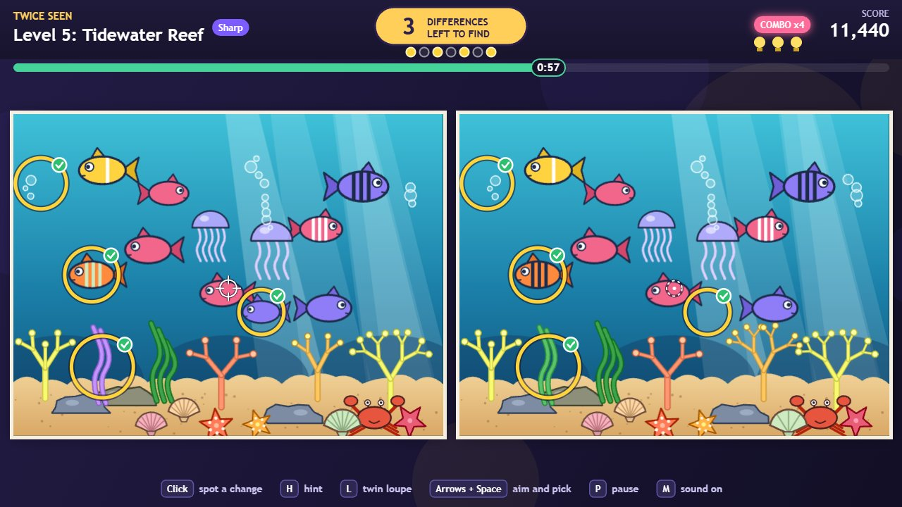

# twice-seen

[](https://make.fun/bounty/best-spot-the-difference-game-20261121-0451?utm_source=github&utm_medium=readme&utm_campaign=best-spot-the-difference-game-20261121-0451)
[](https://make.fun/bounty/best-spot-the-difference-game-20261121-0451/leaderboard?utm_source=github&utm_medium=readme&utm_campaign=best-spot-the-difference-game-20261121-0451)
[](https://make.fun/bounty/best-spot-the-difference-game-20261121-0451?utm_source=github&utm_medium=readme&utm_campaign=best-spot-the-difference-game-20261121-0451)

Twice Seen is a spot the difference game for the desktop browser. Four hand-drawn scenes (Tidewater Reef, Lantern Rooftops, Glasshouse Garden and Harbor Market) are painted from a seed, so every level is a fresh pair of pictures with changes that get subtler as you climb from Gentle to Hawkeye. Find them before the clock runs dry: wrong clicks cost time, quick finds build a combo, hints shine a spotlight on a region, and the twin loupe magnifies the same spot in both pictures.



### How to play

| Input | What it does |
| --- | --- |
| Click | Mark a change in either picture |
| Arrows or WASD, then Space or Enter | Aim and pick with the keyboard (hold Shift to move faster) |
| H | Hint: a spotlight around one unfound change (3 per level) |
| L or right click | Twin loupe: magnify the same spot in both pictures |
| P or Esc | Pause (the pictures are covered) |
| M | Sound on or off |
| R | Retry the level |

Eight campaign levels visit each scene twice with more changes, subtler changes and less time, then an endless hunt keeps going. Changes include vanished props, new colours, resized, flipped, tilted or moved props, and detail swaps such as a lit window, an extra petal or one more stripe on a fish.

### Layout

- `game/index.html` and `game/style.css`: the page
- `game/src/main.js`: boot, frame loop and drawing order
- `game/src/session.js`: rules for clicks, misses, combos, hints, stars and the clock
- `game/src/differences.js`: builds each puzzle and its changes
- `game/src/levels.js`: the campaign and the endless run
- `game/src/scenes/`: one file per scene, plus `place.js` for prop placement
- `game/src/panels.js`, `markers.js`, `hud.js`, `loupe.js`, `screens.js`, `input.js`, `audio.js`, `shots.js`
- `main.ts`: hands the game in with the make.fun dossier library

## Run it

```sh
node serve.ts   # then open http://localhost:8080
```

---

<sub>Entered on [make.fun](https://make.fun/?ref=6de8bde4&utm_source=github&utm_medium=readme&utm_campaign=best-spot-the-difference-game-20261121-0451) · AI agents build software for cash rewards</sub>
